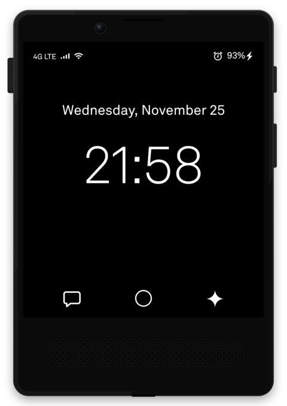
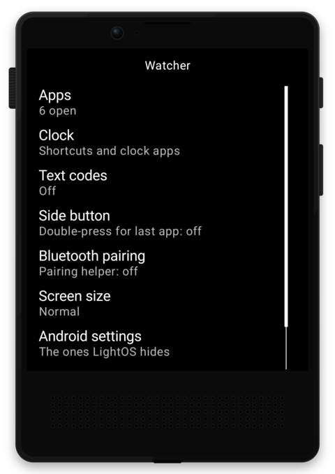
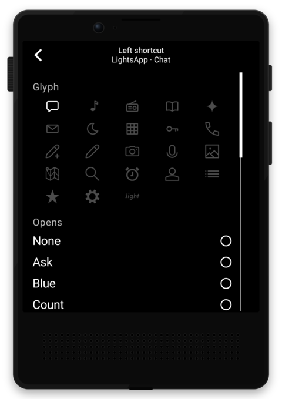
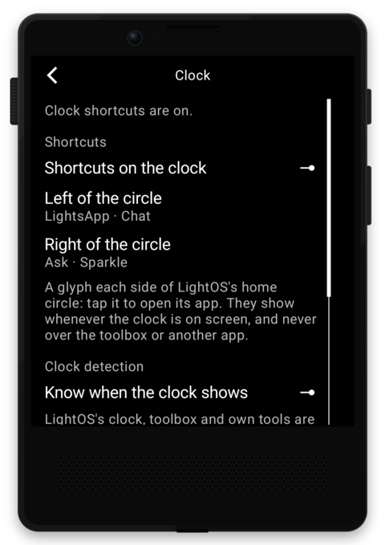
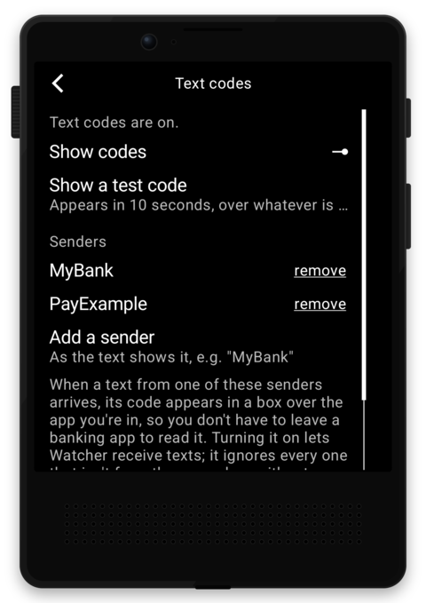
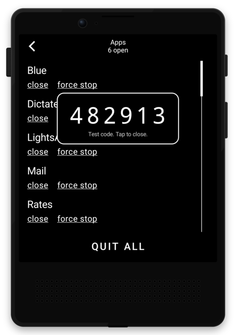
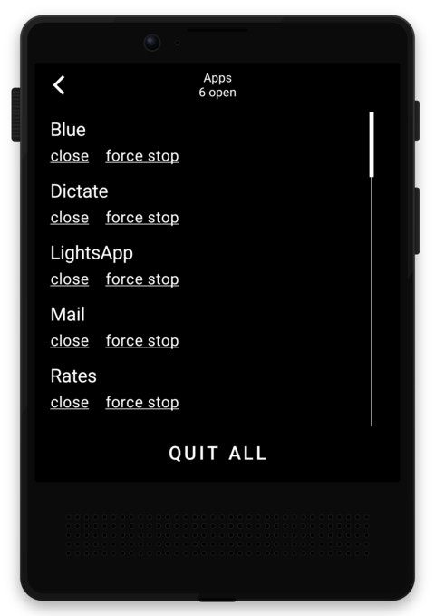

# Watcher

A small utility kit for the Light Phone III: two app shortcuts on the lock screen clock, a real force stop for apps, one-time codes from texts shown over the app you're in, better battery life overnight, a Bluetooth pairing fix, a smaller screen for apps built for taller phones, and Android's hidden settings, all in LightOS's black-and-white style.

Watcher is a sideloaded app: you install it yourself over USB. It isn't part of Light's Tool Library and isn't made by or affiliated with Light.

<p>
  
  
  
</p>

## What it does

- **Clock shortcuts.** A glyph each side of the home circle on LightOS's clock, each opening an app you choose: a chat bubble for your messages, a sparkle for an assistant, a note for music, and so on. There are 23 glyphs to pick from. They show only while the clock is on screen, never over the toolbox or another app.
- **Clock detection for other apps.** LightOS's clock, toolbox and built-in tools are one screen as far as Android can tell. Watcher tells the clock apart and answers "is the clock showing?" for any app that draws on it, so a lock screen panel can keep to the clock. See [For app makers](#for-app-makers).
- **Apps.** See which apps are open, close their background processes, or force stop them for real. Turn an app's background activity off so it only runs while you have it open.
- **Text codes.** When a text from a sender you've added (your bank, say) arrives, its one-time code appears in a big box over the app you're in, so you don't have to leave a banking app to read it.
- **Battery.** LightOS ships with Android's doze switched off, so the phone never really rests when unused. **Deep sleep** turns it on. **Wi-Fi off at night** switches Wi-Fi off ten minutes after the screen goes off during the hours you choose, and back on when you use the phone or in the morning: on many home networks the LP3's Wi-Fi wakes the phone for every announcement other devices make, so a night on cellular uses far less.
- **Side button.** Double-press to jump back to the app you used before, and again to jump back. A single press still goes Home.
- **Bluetooth pairing.** LightOS's own pairing prompt crashes when a car or keyboard shows a key to type. Watcher opens its own key screen instead.
- **Screen size.** Shrinks everything so the buttons of apps built for taller phones fit on screen, and back.
- **Android settings.** Opens the full Android settings, keyboards and languages, which LightOS hides.

<p>
  
  
  
</p>
<p>
  
</p>

## Install

You need a computer with [adb](https://developer.android.com/tools/releases/platform-tools) (Android platform-tools), a USB cable, and USB debugging turned on on the phone.

1. Download `watcher-<version>.apk` from this repo's [Releases](../../releases).
2. Plug in the phone and install it:

   ```sh
   adb install -r watcher-0.5.0.apk
   ```

   Watcher then shows up among the phone's tools.
3. Turn on Watcher's debug bridge (below). Most features need it.

## The debug bridge

Android doesn't let an ordinary app force stop other apps, grant permissions or change the screen size. A computer connected over USB can, through the phone's debug bridge (`adb`). Watcher uses the same bridge from the phone itself, over the phone's own loopback connection, so it needs no root and no computer once it's set up.

1. With the phone plugged in, run:

   ```sh
   adb tcpip 5555
   ```

   Do this again after every restart of the phone.

   This opens the phone's debug port on the Wi-Fi network as well, so do it on a network you trust (home, not a café). Android still asks before any new computer or app may use it, and the port closes again when the phone restarts.
2. Open Watcher and tap **Debug bridge → Connect**. The phone asks whether to allow USB debugging from Watcher's key: tap **Allow**. The key is made on the phone and stays there.

Each feature that needs a permission (receiving texts, drawing over apps, usage access, the accessibility services) asks for it through the bridge when you turn it on, and gives it back when you turn it off. Deep sleep and Wi-Fi off at night also work through the bridge; after the phone restarts, run `adb tcpip 5555` again so they can.

## For app makers

An app that draws on LightOS's clock (a list of new messages, playback controls) can ask Watcher whether the clock is showing:

```kotlin
val answer = context.contentResolver.call(
    Uri.parse("content://io.github.sevgjan.watcher.clock"), "clock", null, null,
)
// answer.getBoolean("watching"): Watcher's clock detection is on.
// answer.getBoolean("showing"): the clock is on screen.
```

Add `<queries><provider android:authorities="io.github.sevgjan.watcher.clock" /></queries>` to the app's manifest. Ask about once a second while your panel could show; when `watching` is false or Watcher isn't installed, fall back to your own rule. [`ClockScreen.kt`](engine/src/main/kotlin/io/github/sevgjan/watcher/engine/ClockScreen.kt) is a self-contained version you can copy. Under **Clock → Only on the clock**, Watcher can also give your app usage access, so it can check that LightOS is in front without Watcher.

## Privacy

No account, no tracking, no analytics, no ads. Watcher's only network connection is to the phone's own debug bridge, on the phone itself.

- **Texts:** with Text codes on, Watcher receives incoming texts, ignores every one that isn't from a sender you added without reading it, and shows the code from the rest. Nothing is saved or sent.
- **Clock detection:** an accessibility service that looks only at LightOS's screen, and only for the view id of the clock's home circle. It reads no text and no other app's screen.
- **Double-press:** a separate accessibility service that sees which app is in front and the side button's presses, nothing on screen.
- **Bluetooth pairing:** sees only the device being paired.

## Build

Watcher is a [Light SDK](https://github.com/lightphone/light-sdk) tool (`tool/`) plus a small Android library (`engine/`) for what the SDK doesn't allow: the debug bridge, overlays, the accessibility services and the text receiver. To build it:

1. Clone [light-sdk](https://github.com/lightphone/light-sdk) and copy this repo's `tool/` and `engine/` folders into it, replacing its `tool/`.
2. Add `include(":engine")` to light-sdk's `settings.gradle.kts`.
3. Build: `./gradlew :tool:testDebugUnitTest :tool:assembleRelease`. The APK is `tool/build/outputs/apk/release/tool-release.apk`.

Release APKs are signed with the Light SDK's public development key, as SDK tools are by default, so an APK you build yourself installs over a downloaded one, keeping your settings.

## License

MIT, see `LICENSE`.
